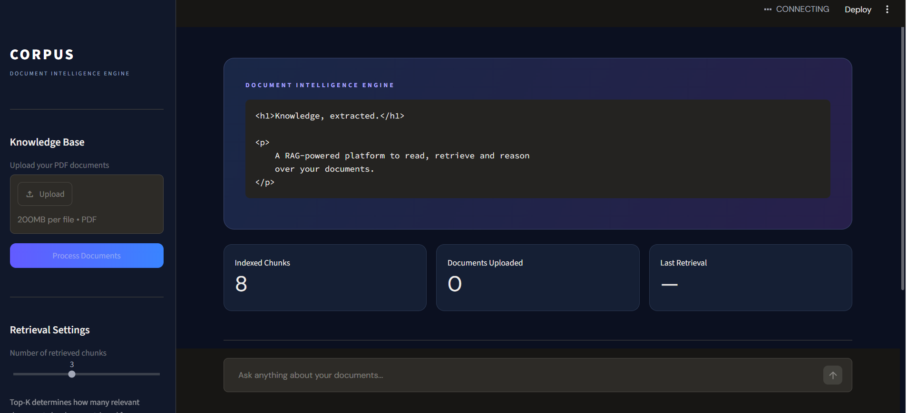
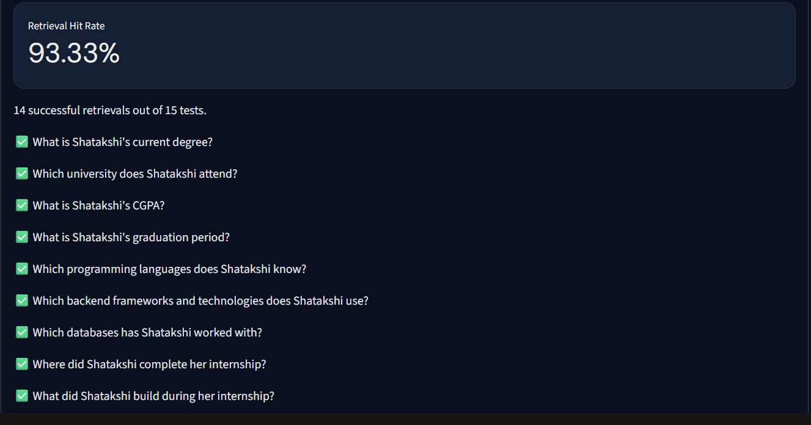
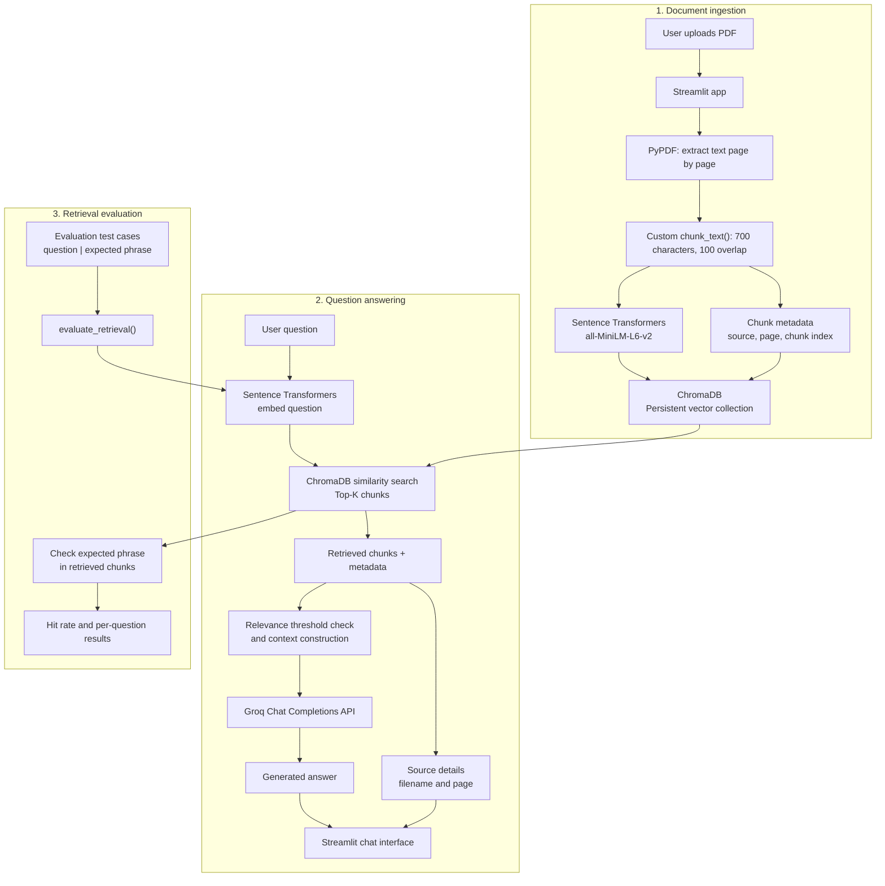

# CORPUS — Document Intelligence Engine

**Knowledge, extracted.**

A RAG-powered platform to read, retrieve and reason over your documents.

Corpus is a PDF question-answering application that combines semantic retrieval with an LLM. It extracts text from uploaded PDFs, divides the text into overlapping chunks, embeds those chunks, stores the vectors in ChromaDB, and retrieves relevant passages when a user asks a question. The retrieved passages are then supplied to a Groq-hosted language model to generate a grounded response with source references.

> **Implementation note:** Corpus uses a custom Python RAG pipeline built with individual libraries. It does **not** use LangChain.

---

## Screenshots

### Corpus application



### Retrieval evaluation



---

## What it does

- Upload and process one or more PDF documents.
- Extract text page by page with PyPDF.
- Split extracted text into overlapping chunks.
- Generate vector embeddings using `all-MiniLM-L6-v2` from Sentence Transformers.
- Store document chunks, embeddings and metadata in a persistent ChromaDB collection.
- Convert a user question into an embedding and retrieve the most relevant chunks using vector similarity search.
- Send retrieved context to a Groq-hosted LLM to generate an answer.
- Display retrieved source filenames, page numbers and similarity scores.
- Track retrieval and generation latency.
- Evaluate retrieval using a manually curated question-and-expected-phrase test set.

## Architecture

The application has two main paths: **document ingestion** and **question answering**. Retrieval evaluation reuses the retrieval path with a separate set of test questions.



### Runtime flow

**Ingestion**
1. The user uploads a PDF through Streamlit.
2. PyPDF extracts text from each page.
3. `chunk_text()` creates chunks of 700 characters with 100 characters of overlap.
4. Sentence Transformers converts each chunk into an embedding.
5. ChromaDB stores the chunk text, embedding and metadata (`source`, `page`, and `chunk`).

**Question answering**
1. The user's question is embedded with the same embedding model.
2. ChromaDB retrieves the nearest chunks using cosine-distance-based similarity search.
3. The application constructs a context from the retrieved chunks.
4. The Groq API generates an answer using the supplied context and the application prompt.
5. Corpus displays the answer, retrieved sources, similarity values and timing metrics.

**Retrieval evaluation**
1. The user supplies test cases in `question | expected phrase` format.
2. `evaluate_retrieval()` retrieves Top-K chunks for each question.
3. A test is counted as a hit when its expected phrase is found in the retrieved text.
4. The application reports the hit rate and individual test outcomes.

---

## Technology stack

| Area | Technology | Purpose |
|---|---|---|
| Language | Python | Application and RAG pipeline |
| UI | Streamlit | Document upload, chat interface and evaluation UI |
| PDF processing | PyPDF | Page-level PDF text extraction |
| Chunking | Custom Python implementation | Character-based chunking with overlap |
| Embeddings | Sentence Transformers (`all-MiniLM-L6-v2`) | Text and query embeddings |
| Vector database | ChromaDB | Persistent vector storage and similarity search |
| LLM API | Groq | Context-grounded answer generation |
| Configuration | python-dotenv | Load API key and model configuration |
| Evaluation | Custom Python evaluation module | Retrieval hit-rate measurement |

---

## Retrieval configuration

The current implementation uses:

| Parameter | Current value |
|---|---:|
| Chunk size | 700 characters |
| Chunk overlap | 100 characters |
| Default Top-K | 3 |
| Embedding model | `all-MiniLM-L6-v2` |
| Vector distance metric | Cosine |
| Retrieval rejection threshold | Distance greater than 0.65 |

Top-K can be changed in the Streamlit sidebar. Chunk size and overlap are constants in `rag.py`. Changing chunking settings requires re-indexing the documents; use a clean collection or clear the previous indexed data when comparing configurations.

---

## Retrieval evaluation

The current manually curated evaluation run used **15 questions** based on a resume PDF.

| Metric | Result |
|---|---:|
| Successful retrievals | 14 / 15 |
| Retrieval hit rate | **93.33%** |
| Top-K | 3 |
| Test questions | 15 |

The hit rate is calculated as:

\[
\text{Hit Rate} = \frac{\text{Successful retrievals}}{\text{Total test cases}} \times 100
\]

**How to interpret this result:** A test passes when the expected phrase appears in at least one of the retrieved Top-K chunks. Therefore, 93.33% is the result for this specific 15-question test set and phrase-matching evaluation method. It is not a measure of LLM answer correctness, factuality, citation accuracy, or general performance across arbitrary documents.

---

## Project structure

```text
corpus-RAG/
├── app.py                 # Streamlit interface and application flow
├── rag.py                 # PDF ingestion, chunking, indexing, retrieval and generation
├── evaluation.py          # Retrieval hit-rate evaluation
├── requirements.txt       # Python dependencies
├── .env                   # Local secrets and model configuration (not committed)
├── .gitignore             # Excludes secrets, environments and generated data
├── README.md
├── tests/
│   └── test_rag.py        # Tests, if included in this repository
└── data/
    └── chroma_db/         # Persistent local ChromaDB data (generated at runtime)
```

---

## Run locally

### 1. Clone the repository

```bash
git clone https://github.com/shatakshi-1404/corpus-RAG.git
cd corpus-RAG
```

### 2. Create and activate a virtual environment

**Windows PowerShell**

```powershell
py -m venv venv
.\venv\Scripts\Activate.ps1
```

**macOS / Linux**

```bash
python -m venv venv
source venv/bin/activate
```

### 3. Install dependencies

```bash
pip install -r requirements.txt
```

### 4. Configure environment variables

Create a `.env` file in the project root:

```env
GROQ_API_KEY=your_groq_api_key
GROQ_MODEL=openai/gpt-oss-120b
```

Keep `.env` private. Do not commit API keys.

### 5. Start Corpus

```bash
streamlit run app.py
```

Streamlit will print a local URL, usually `http://localhost:8501`.

---

## Using the application

1. Open Corpus in your browser.
2. Upload one or more PDF files in the sidebar.
3. Select **Process Documents** to extract, chunk, embed and index the PDFs.
4. Ask a question in the chat input.
5. Inspect the retrieved source passages, page numbers and similarity scores.
6. Open **Evaluate RAG Retrieval** to run a set of test cases.

Evaluation cases use one line per test:

```text
What is the candidate's CGPA? | 8.56
Which university does the candidate attend? | VIT Bhopal
Which algorithm is used for readiness scoring? | logistic
```

The expected phrase should be present in the relevant document text. Keep the evaluation document indexed before running the tests.

---

## Design decisions

- **Build the RAG pipeline directly:** The project uses the underlying libraries without a framework such as LangChain, making the ingestion, embedding, retrieval and generation steps explicit.
- **Persist vectors locally:** ChromaDB's persistent client keeps the indexed collection between application restarts.
- **Preserve source metadata:** Each chunk stores its source filename and PDF page number so retrieved context can be traced back to a document.
- **Use overlapping chunks:** Overlap helps retain context when relevant text falls near a chunk boundary.
- **Measure retrieval separately:** The evaluation module tests whether expected information is retrieved, independently of the LLM's generated response.

## Current limitations

- Text extraction depends on selectable text in the PDF; scanned PDFs may require an OCR stage.
- Chunking is character-based rather than structure-aware or token-based.
- Retrieval evaluation uses expected-phrase matching on a small manually created test set.
- The fixed distance threshold and Top-K settings may need calibration for different document collections.
- The generated response is prompted to cite sources, but citations are not independently verified against the retrieved passages.
- The local ChromaDB collection is intended for this project instance, not multi-user production deployment.

## Future improvements

- Add OCR support for scanned PDFs.
- Compare chunk sizes, overlap values and Top-K settings through repeatable experiments.
- Add semantic evaluation of answer relevance, faithfulness and citation correctness.
- Explore hybrid keyword and vector retrieval, followed by reranking.
- Add document management features such as deletion and re-indexing.
- Add automated tests for ingestion, retrieval and evaluation.

---

## Author

**Shatakshi Prasad**

- GitHub: [@shatakshi-1404](https://github.com/shatakshi-1404)
- Repository: [corpus-RAG](https://github.com/shatakshi-1404/corpus-RAG)
